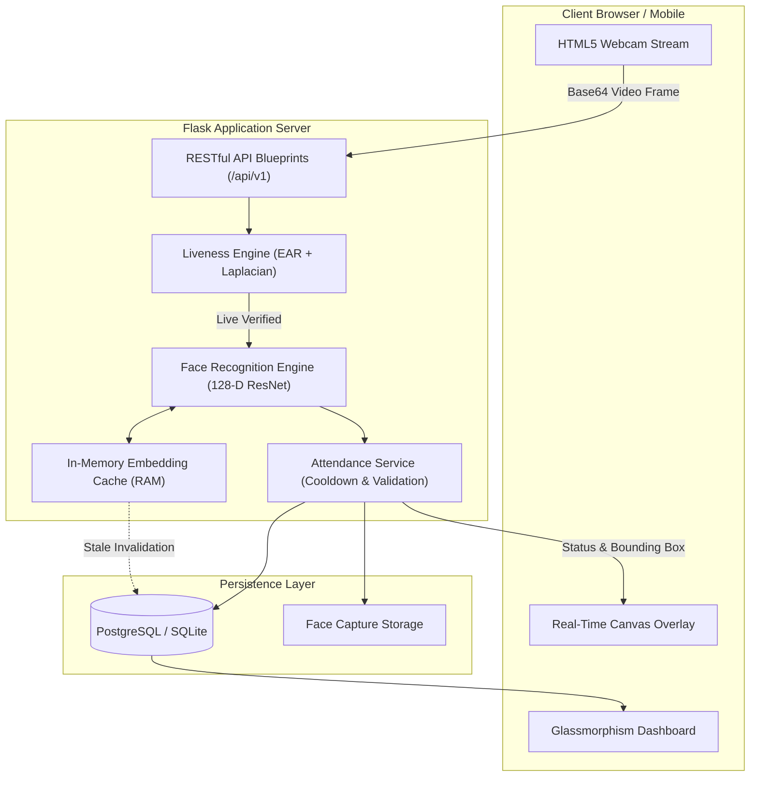

# PresencePro — Attendance Operations Platform

PresencePro is an enterprise-grade, real-time facial recognition attendance platform built with Flask, OpenCV, dlib, and PostgreSQL. It features a responsive dark-glassmorphism user interface, in-memory embedding caching, anti-spoofing liveness detection, and automated cloud deployment.

---

## ✨ Key Features

- **Real-Time Facial Recognition**: Sub-second face recognition powered by 128-dimensional dlib ResNet face embeddings.
- **Anti-Spoofing & Liveness Detection**: Multi-layer spoof protection utilizing **Eye Aspect Ratio (EAR)** landmarks and **Laplacian sharpness variance analysis** to block static photos and digital screen replays.
- **In-Memory Embedding Caching**: $O(1)$ memory lookup cache for vector comparisons, preventing repetitive database queries during high-frequency camera scanning.
- **Dynamic Bounding Box & Audio Feedback**: Real-time canvas overlay rendering facial bounding boxes, confidence tags, liveness verification badges, and Web Audio melodic confirmation chimes.
- **Student & Enrolment Management**: Multi-angle image capture and automated embedding generation with quality checks.
- **Attendance History & Analytics**: Filterable logs, duplicate prevention with cooldown thresholds, and Chart.js analytics for department and session trends.
- **Security & Access Control**: JWT authentication, Bcrypt salted password hashing, and role-based route guards.
- **Automated Test Suite**: Unit and integration test suite with `pytest` covering authentication, attendance cooldowns, and anti-spoofing logic.

---

## 🛠️ Technology Stack

| Layer | Technologies |
| :--- | :--- |
| **Backend** | Python 3.11, Flask 3.0, Flask-SQLAlchemy, Flask-JWT-Extended, Flask-Bcrypt, Gunicorn |
| **Computer Vision** | OpenCV Headless, dlib (pre-compiled binary wheels), face_recognition, NumPy |
| **Database** | PostgreSQL (Production) / SQLite (Development Fallback) |
| **Frontend** | Vanilla JavaScript (ES6+), HTML5 Canvas, Glassmorphism CSS, Chart.js, Web Audio API |
| **Testing & DevOps** | Pytest, Docker, Render Blueprint (`render.yaml`), Git |

---

## 🏗️ Architecture & System Design



---

## 📁 Directory Structure

```text
PresencePro/
├── .github/                 # Git & repository metadata
├── src/
│   ├── api/                 # REST API Blueprints (auth, students, attendance, recognition, config)
│   ├── ml/                  # Computer vision algorithms (detection, recognition, liveness)
│   │   ├── face_detection.py
│   │   ├── face_recognition_engine.py
│   │   ├── liveness.py      # Eye Aspect Ratio & anti-spoofing engine
│   │   └── preprocessor.py  # Image quality & normalization
│   ├── models/              # SQLAlchemy database models
│   ├── services/            # Core business logic layer
│   ├── utils/               # Helpers, token decorators, and validators
│   └── views.py             # Frontend HTML page routing
├── static/                  # Glassmorphism CSS, vanilla JS modules, branding assets
├── templates/               # Jinja2 HTML templates
├── tests/                   # Automated Pytest suite
│   ├── conftest.py          # Fixtures & in-memory test database
│   ├── test_auth.py         # Login & JWT authorization tests
│   ├── test_attendance.py   # Marking & cooldown rule tests
│   └── test_liveness.py     # Anti-spoofing & EAR algorithm tests
├── Dockerfile               # Production container definition
├── render.yaml              # Render Cloud Infrastructure as Code blueprint
├── requirements.txt         # Production dependencies
├── config.py                # Environment configurations (Dev / Prod / Test)
├── init_db.py               # Database initialisation & admin seeding script
└── run.py                   # Development entry point
```

---

## 🚀 Getting Started (Local Development)

### 1. Prerequisites
- **Python 3.11+**
- Git

### 2. Setup Virtual Environment
```bash
# Clone the repository
git clone https://github.com/Suraj-Gupta-06/PresencePro-Attendance-Operations-Platform.git
cd PresencePro-Attendance-Operations-Platform

# Create virtual environment
python -m venv venv

# Activate (Windows)
venv\Scripts\activate
# Activate (Linux/macOS)
source venv/bin/activate
```

### 3. Install Dependencies
```bash
pip install --upgrade pip
pip install -r requirements.txt
pip install --no-deps face-recognition==1.3.0
```

### 4. Initialize Database
```bash
python init_db.py
```
*Default Admin Account:*
- **Email:** `admin@admin.com`
- **Password:** `Admin@123`

### 5. Run the Server
```bash
python run.py
```
Open **`http://127.0.0.1:5000`** in your browser.

---

## 🧪 Running Automated Tests

Run the full test suite with `pytest`:
```bash
pytest -v
```

---

## 🌐 Production Cloud Deployment (Render / Docker)

The repository includes a ready-to-use Render Blueprint:
1. Connect your repository in the [Render Dashboard](https://dashboard.render.com).
2. Choose **Blueprint** deployment.
3. Render reads `render.yaml` and provisions:
   - A managed PostgreSQL instance.
   - A Web Service with Python 3.11, automatic database seeding, and Gunicorn process management.

---

## 📄 License
This project is licensed under the MIT License.
